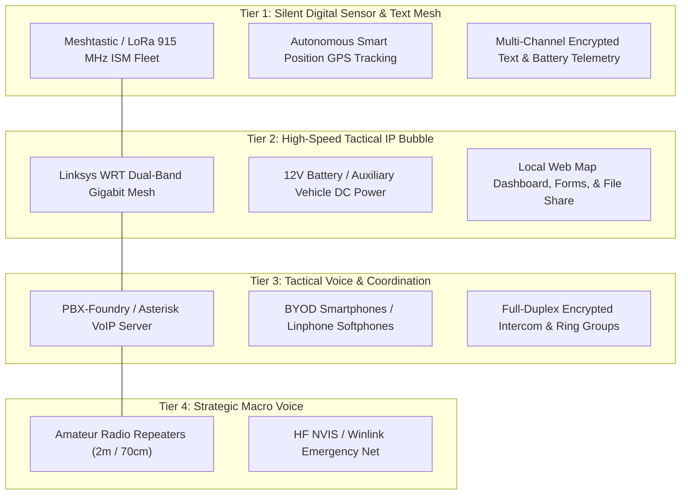
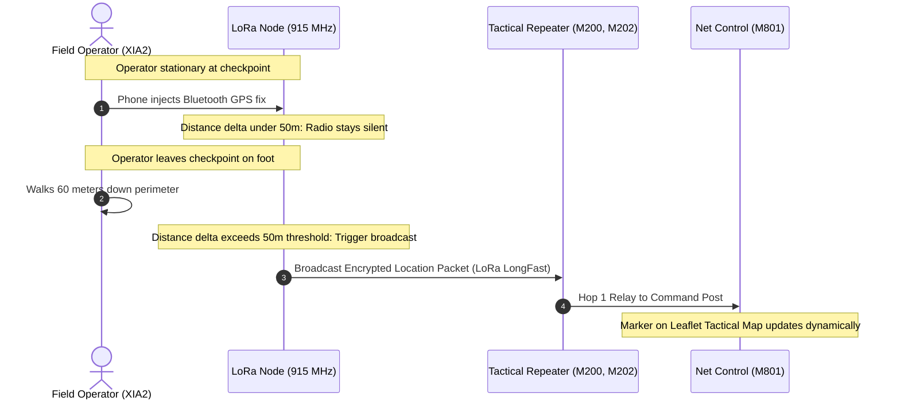
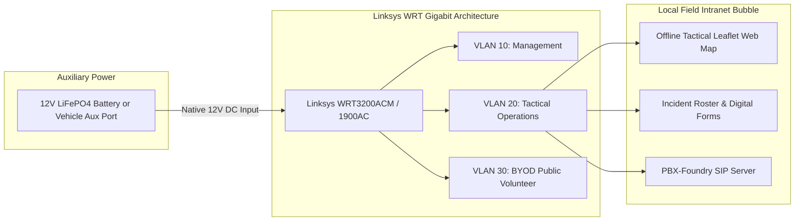
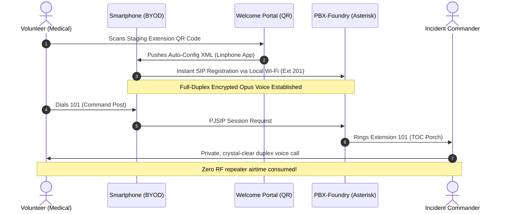
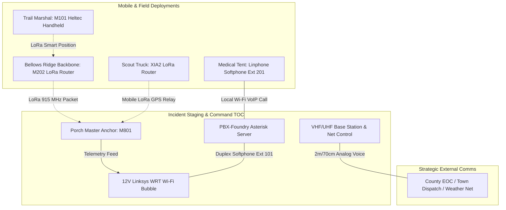

# Beyond the Handheld: A Practical Journey Integrating LoRa, 12V Wi-Fi Mesh, and Tactical VoIP Alongside Ham Radio

**Field Notes, Architecture, and Lessons from Network & PBX Foundry for Community Events and Emergency Operations**

*Author: Michael Jackson*  
*Date: October 2026*  
*Project: Network-Foundry / PBX-Foundry*  
*Target Audience: Amateur Radio Operators, Community Event Volunteers, and Emergency Comms Teams*

---

## Executive Summary & Elmer's Note

For decades, amateur radio operators have been the backbone of community public-service communications. Whether staffing water stops along a marathon, tracking floats in a town parade, or standing watch during severe weather activations, our default reflex is predictable and time-honored: **grab a 2-meter handheld, dial into the local repeater, and establish a voice directed net.**

Analog FM voice on VHF and UHF is simple, robust, and familiar. But anyone who has managed net control during a fast-moving community event has experienced the friction points:

* **Channel Congestion:** Reading 10-character GPS coordinates, medical triage notes, or 6-item supply requests over voice ties up the repeater for 45 to 60 seconds at a time while urgent traffic queues up.
* **The Non-Ham Volunteer Gap:** Event marshals, medical staff, Red Cross volunteers, and municipal coordinators who do not hold an FCC amateur license cannot legally transmit on our frequencies, forcing clumsy phone-to-radio relay handoffs.
* **Pen-and-Paper Inefficiencies:** Incident commanders squinting at handwritten paper rosters taped to a folding table, trying to track where 15 mobile volunteers are positioned on foot or in vehicles.

Over the last several weeks in our local workshop and field test runs—what we’ve termed **Network-Foundry** and **PBX-Foundry**—we set out on a hands-on journey to explore a practical question:

> *Can we build a deployable, resilient, multi-tier communications capability that offloads routine data and volunteer voice traffic to mature digital technologies, while preserving our amateur radio repeaters for high-priority command and wide-area traffic?*

The answer is an emphatic **yes**. This paper outlines the journey we followed, the hardware we tested in our vehicles and on foot, the architectural tiers that emerged, and why we believe these tools are now mature, reliable, and ready for real-world community service.

---

## 1. The Core Philosophy: Layered Communications (Defense in Depth)

We did not embark on this project to replace amateur radio. Amateur radio remains our strategic macro-layer: it connects our town to county EOCs, state networks, Skywarn, and distant repeaters without dependence on commercial infrastructure.

Instead, our goal was **traffic offloading and operational clarity**. When you analyze an afternoon of community event traffic, it naturally divides into four distinct categories:

1. **Autonomous Telemetry & Beaconing:** *"Where is the scout truck right now? What is the battery voltage on the ridge relay?"* (Machines should send this silently, not humans speaking over voice).
2. **Short Tactical SITREPs & Logistics Queries:** *"Water Station 3 is down to 2 pallets of cups."* (A 5-word digital text is faster, silent, and leaves a persistent audit log on the screen).
3. **Private, High-Context Coordination:** *"We have a runner with heat distress at Mile 4 who needs a confidential medical assessment before dispatching an ambulance."* (This should never tie up an open repeater, nor should sensitive medical details be broadcast over public analog frequencies).
4. **Strategic Command & Inter-Agency Voice:** *"Incident Commander to County Dispatch: Requesting one mutual aid ambulance to Sector 2."* (This is the rightful home of our VHF/UHF tactical voice nets).

To serve these distinct needs, a **Tri-Tier Communications Architecture** emerged:

---

## 2. Tier 1: The LoRa & Meshtastic Discovery (The Silent Backbone)

Our first major milestone was deploying **Meshtastic on 915 MHz ISM LoRa**. While many hams know LoRa as a low-baud digital modulation, Meshtastic wraps it in an autonomous, decentralized packet-mesh protocol with zero single points of failure.

### Why 915 MHz ISM Matters for Community Events
Because 915 MHz ISM is license-free under FCC Part 15, non-ham volunteers—CERT members, race organizers, scout leaders—can carry handheld nodes and exchange text messages or broadcast their locations legally. Furthermore, unlike amateur bands where encryption is strictly prohibited, Part 15 ISM allows full **AES-256 cryptographic segmentation**.

### The Cryptographic Channel Hierarchy
Rather than dumping all traffic onto one noisy public channel, we implemented a standardized 6-channel hierarchy across our fleet:

| Channel Index | Channel Name | Role | Encryption | Operational Purpose |
|:---:|:---|:---:|:---:|:---|
| **0** | `Primary` | PRIMARY | Public Default (`AQ==`) | Volunteer check-in and general community interop |
| **1** | `CMD-EOC` | SECONDARY | AES-256 | Incident Command, TOC staff, and sensitive command SITREPs |
| **2** | `OPS-TEAMS`| SECONDARY | AES-256 | Search parties, roving patrols, and perimeter security |
| **3** | `LOG-MED` | SECONDARY | AES-256 | Medical triage, transport dispatch, and supply requests |
| **4** | `SYS-TELEM`| SECONDARY | AES-256 | Automated battery voltages, solar metrics, and sensor reports |
| **5** | `ADMIN` | SECONDARY | AES-256 | Cryptographic remote Over-The-Air (OTA) maintenance |

### Smart Position: Eliminating Voice Location Check-Ins
One of our biggest "aha!" moments during field testing came when walking the perimeter with our pocket node (`XIA2`). 

Traditionally, a net control operator spends half their time asking: *"Scout 1, report your location."* The operator stops, checks a landmark, clicks PTT, and speaks. 

With Meshtastic’s **Smart Position** algorithm enabled (`broadcast_smart_minimum_distance = 50m`, `broadcast_smart_minimum_interval = 30s`):
* While the operator is stationary at their post, the radio stays silent, saving battery and airtime.
* As soon as the operator begins walking and crosses 50 meters from their last fix, the node automatically broadcasts an updated GPS packet over the mesh.
* Net control's computer receives the packet and instantly moves the operator’s icon across the live web map. **Zero voice airtime consumed.**

### The Hardware Fleet
We built and standardized our fleet using three accessible, affordable hardware classes:
* **Seeed Studio XIAO ESP32-S3:** Ultra-compact pocket/vehicle EDC nodes (`XIA1`, `XIA2`). Paired with a smartphone over BLE, the phone acts as the GPS source, screen, and keyboard.
* **RAK Wireless RAK4631 (WisBlock nRF52840):** Ultra-low-power backbone nodes (`M200`, `M201`, `M202`). Capable of running for weeks on small solar panels or months on modest battery packs, these act as hilltop and ridge repeaters.
* **Heltec V3 / V4 Handhelds:** Screen-equipped, all-in-one portable communicators (`M101` through `M106`) with integrated displays, ideal for roving field volunteers.

---

## 3. Tier 2: The 12V Wi-Fi Intranet (Deployable High-Bandwidth Bubble)

While LoRa is unmatched for low-power, kilometer-range text and telemetry, it has virtually zero bandwidth (measured in bits per second). When net control needs to display a live topographical map, review digital registration rosters, or share event logistics documents, an IP network is essential.

Rather than relying on commercial cellular hotspots (which frequently congest or fail during large crowds and severe weather), we turned to a battle-tested piece of surplus hardware: **the Linksys WRT dual-band gigabit router series** (WRT1200AC, WRT1900AC, WRT3200ACM).

### Why Repurposed Linksys WRT Routers?
1. **Native 12V DC Operation:** The barrel jack on standard Linksys WRT routers runs directly off 12V DC. By soldering standard automotive auxiliary plugs and Anderson Powerpole connectors, we eliminated inefficient DC-to-AC inverters. A single 12V 20Ah LiFePO4 battery powers an entire multi-band tactical access point and switch for over 24 hours.
2. **High-Power RF & Removable Antennas:** With RP-SMA connectors, stock antennas can be swapped for high-gain magnetic vehicle mounts or elevated masts, blanketing an entire staging field or parking pavilion.
3. **Local Intranet Services:** Connected to a low-draw Linux laptop or thin client at the command post, the Wi-Fi network serves:
   * Real-time tactical maps showing live Meshtastic node positions.
   * Shared digital incident logs.
   * Local documentation and emergency action plans accessible by any volunteer connected to the Wi-Fi.

---

## 4. Tier 3: PBX-Foundry (Tactical VoIP & Ephemeral BYOD Softphones)

The most intriguing capability to emerge from our workshop over the past week was **PBX-Foundry**: bringing private, full-duplex voice dispatch to the field without touching radio frequencies.

### The Problem It Solves
Consider a typical 10K road race. At the finish line, the medical director needs to speak with the head triage nurse at the medical tent. If they use the main ham net, every runner tracking call is paused while they discuss an athlete's condition. If they use commercial cell phones, spotty cell service or dead zones often block the call.

### How PBX-Foundry Works
Inside our 12V Wi-Fi bubble, we spin up a lightweight, containerized **Asterisk / PJSIP micro-PBX** on a workstation or mini-PC:

### Key Operational Features:
* **Ephemeral BYOD Provisioning:** Volunteers download a free SIP client (like Linphone) to their personal iPhone or Android. At the morning briefing, they scan a printed QR code at the registration table. Within seconds, their personal phone is provisioned as an authenticated, temporary extension (e.g., `Ext 201: Medical Triage`, `Ext 301: Water Station Lead`).
* **Tactical Ring Groups & Intercom:** Net control can dial `*800` to ring all medical staff simultaneously, or dial a single extension for a quiet, one-on-one coordination conversation.
* **Crystal-Clear Full Duplex:** Using modern wideband audio codecs (like Opus), audio quality is telephone-grade or better, completely immune to RF static, picket-fencing, or repeater squelch tails.

---

## 5. A Realistic Scenario: Putting the Multi-Tier Mesh into Action

To see how these pieces fit together smoothly in real life, consider a simulated community event (such as a multi-mile community trail run or fair):

1. **Continuous Situational Awareness:** The trail marshal (`M101`) and the roving scout vehicle (`XIA2`) move along the course. Their radios silently transmit coordinates every 50 meters. Net control watches their icons progress across a map in real time. **Zero voice calls made.**
2. **Medical Coordination:** An injured runner arrives at the medical tent. The triage nurse picks up her smartphone, connected to the local staging Wi-Fi, and dials extension `101`. She speaks in full duplex with the medical director about patient transport, keeping confidential health information off the public radio waves.
3. **Command Decision:** The incident commander decides that municipal mutual aid is required. The ham net control operator picks up the 2-meter microphone and contacts the regional town dispatcher on the local 146.52 simplex or regional repeater. **The ham repeater is completely quiet, clear, and instantly available for the priority call.**

Every tier did precisely what it was designed to do, without competing for bandwidth or stepping on other operators.

---

## 6. What We Learned: Field Lessons & Practical Advice

Throughout our testing, configuring, and field troubleshooting, several valuable lessons emerged:

### 1. Protobufs and Automation Beat Manual Phone Taps
Configuring 10 or 15 radios manually using a smartphone app takes hours and invites configuration drift (e.g., mismatched channel keys or typoed admin keys). Writing small Python helper scripts to query the radios over USB and write binary protobuf configurations allowed us to audit, re-key, and verify a radio in under 10 seconds.

### 2. Pay Attention to Node Roles
In Meshtastic, not every node should be a `ROUTER`. If multiple handhelds on the ground are set to repeat packets indiscriminately, they can cause channel contention. Setting handhelds to `CLIENT` or `CLIENT_MUTE` and reserving `ROUTER` or `ROUTER_CLIENT` status for elevated, permanent anchors (like `M200` on the ridge or `M801` at the TOC) keeps channel utilization pristine.

### 3. Native 12V DC is a Superpower
Eliminating inverters across our network gear lowered our idle power draw dramatically, eliminated RF hash and switching noise on the ham bands, and made our gear plug-and-play with common emergency power sources (Anderson Powerpoles, deep-cycle marine batteries, and solar charge controllers).

---

## 7. An Invitation to Experiment

Amateur radio has never been about standing still. From spark gap to AM, from single sideband to packet radio, APRS, and DMR, the amateur service has always led the exploration of what is possible on the airwaves.

The concepts we’ve shared here are not theoretical laboratory prototypes. They are built from accessible, commercial-off-the-shelf boards costing between $25 and $60, surplus gigabit routers readily found online or in workshops, and open-source software maintained by active, dedicated communities.

We share this journey not as an end point, but as an open invitation:
* **Curious about how a LoRa mesh behaves across our town’s terrain?** Let’s stage a ridge test.
* **Want to test a portable Wi-Fi bubble at our next club meeting or public event?** We have the 12V harnesses ready.
* **Want to see a softphone extension ring from a handheld smartphone off-grid?** We’ll demonstrate it live.

If any part of this journey sparks your curiosity, let’s get together, share ideas, and build the next layer of community communication capability together.

---

*73,*  
**Michael Jackson**  
*Network-Foundry & PBX-Foundry Project*  
*Carlisle, MA*
