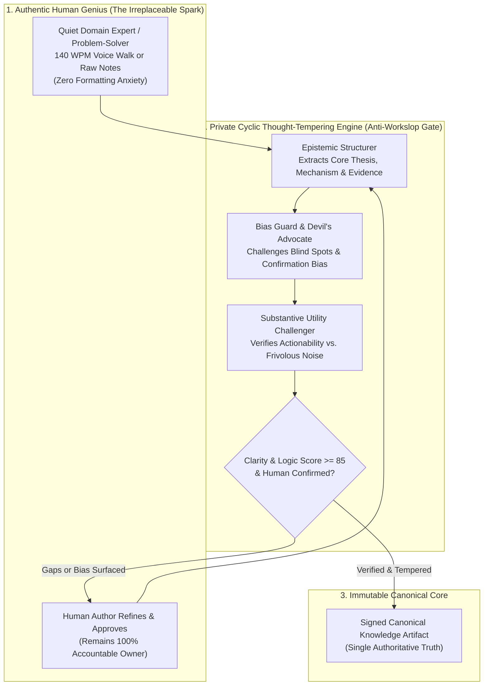
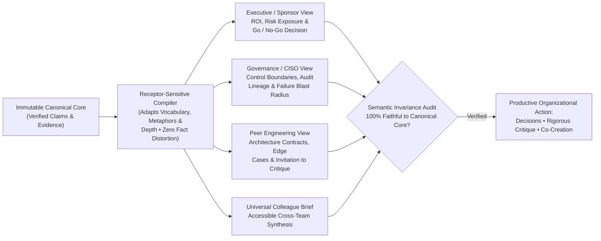
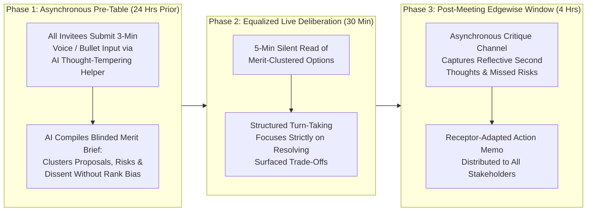

> [!tip] Audience & Live Companion Experiment
> **Who this page is for:** Enterprise executives, consulting and engineering leaders, product directors, and PMO teams navigating the 2026–2027 AI transition.  
> **Live Receptor-Adaptation Proof:** This essay and its companion public monograph—[[Essays/the-cognitive-equalizer|The Cognitive Equalizer: Reclaiming AI from Generative Slop to Unlock Trapped Human Genius]]—were compiled without distortion from the exact same November 19, 2026 walking voice dictation, demonstrating in practice how one immutable canonical truth can be tailored to two distinct audiences. It also extends earlier garden essays on [[Essays/epistemic_communication_and_ai|Signal Fidelity and Epistemic Communication in the Age of AI]] and [[Essays/coordination_crisis_in_the_age_of_ai|The Coordination Crisis in the Age of AI]].

---

# Liberating Trapped Brilliance

### Ending the Charisma Tax in Enterprise Decisions Through Canonical Thought Tempering and Receptor-Adapted AI

#### *An Organizational Blueprint for 2026–2027 Leaders Navigating Workforce AI Anxiety, Synchronous Meeting Dominance, and the \$9 Million "Workslop" Trap*

---

## Executive Abstract

As organizations cross from 2026 into 2027, executives, engineers, and knowledge workers find themselves caught in a palpable tension of **hope, confusion, and skepticism** toward artificial intelligence. According to **Pew Research Center** tracking (2025–2026), **52% of adults feel more concerned than excited** about AI's growing role in daily life—compared to just **9%** who feel primarily excited and **37%** who remain conflicted—while **63%** worry the technology is outpacing human governance. Inside corporations, that unease has been sharpened by a painful return-on-investment paradox: despite aggressive enterprise AI rollouts, joint research by **BetterUp Labs and the Stanford Social Media Lab** published in the *Harvard Business Review* (September 2025) reveals that **40% of desk workers** are now inundated monthly with **"workslop"**—slick, AI-generated slides, summaries, and reports that masquerade as substance while shifting **nearly two hours of remedial cognitive labor per instance** onto colleagues, draining roughly **\$9 million per year for every 10,000 employees** and eroding workplace trust.

Why has first-wave corporate AI produced so much hollow noise while failing to unlock breakthrough organizational intelligence? Because enterprises pointed AI at the wrong bottleneck. They automated *superficial text volume* while leaving untouched the single costliest failure in organizational life: **the premature death of brilliant ideas trapped inside people who struggle to communicate them**.

Every week across executive staff meetings, architecture reviews, and client Steering Committees, organizations pay an invisible **Charisma Tax**. Decades of behavioral science—including **MacLaren et al.'s** *Leadership Quarterly* (2020) proof of the **Babble Hypothesis** and **Anderson et al.'s** *Journal of Personality and Social Psychology* (2012) proof of the **Confidence Heuristic**—demonstrate that human groups systematically mistake *talkativeness and expressed certainty* for *actual competence*. Worse, **Woolley, Chabris, Pentland, and Malone's** landmark *Science* study across **699 participants** proved that when one or two dominant voices commandeer synchronous meeting airtime, **group collective intelligence ($c$) plummets**, regardless of how smart the dominant speakers are individually. Deep systems thinkers, careful risk analysts, and introverted domain specialists routinely hold the exact solution or early warning a program needs—yet cannot get a word in edgewise or lose out to charismatic presenters peddling shallow proposals.

This paper presents an actionable four-part organizational architecture to reverse both failures:
1. **Redirecting AI From "Workslop" & Novelty Demos to Substantive Decision Utility**: Replacing unverified, prompt-and-paste output with human-sparked, accountability-anchored epistemic workflows.
2. **Upstream Cyclic Thought Tempering & Bias Guarding**: Pairing effortless voice/note externalization (~140 WPM vs. ~3.3 WPM high-stakes keyboard hesitation) with **Cyclic Multi-Persona Critique Loops** that stress-test a thinker's raw mental model for blind spots, confirmation bias, and missing evidence *before* publication.
3. **Zero-Distortion Receptor Adaptation**: Resolving **Kalyuga and Sweller's *Expertise Reversal Effect*** by holding a single **Canonical Knowledge Core** invariant while compiling recipient-sensitive projections—adapting vocabulary, metaphors, and abstraction depth for the CFO, CISO, Principal Engineer, or Client Sponsor so comprehension lands and **compels productive action**.
4. **Ending Synchronous Airtime Tyranny via Asynchronous Epistemic Side-Channels**: Operationalizing **Wharton's (*Management Science*)** finding that asynchronous-first ideation yields **3x more ideas and dramatically superior breakthrough outliers** by giving every meeting participant an equalized pre- and post-meeting channel onto the decision table.

---

## 1. The Charisma Tax: Why Great Enterprise Ideas Die in the Room

### 1.1 The Organizational Trilemma of Persuasion vs. Merit

Consider three archetypes present inside virtually every large enterprise, government agency, or consulting practice:
* **The Articulate Amateur**: Possesses shallow domain understanding or a flawed hypothesis, yet speaks with effortless polish, executive presence, and unshakeable certainty.
* **The Opportunistic Empire-Builder**: Pursues turf, vanity metrics, or self-serving agendas wrapped in charismatic storytelling.
* **The Quiet Domain Master**: Sees the three-hop architectural failure mode—or holds an elegant, high-leverage solution constructed entirely in their head—but speaks hesitantly when interrupted, struggles to translate deep mental models into punchy soundbites on the fly, and watches their idea get brushed aside in thirty seconds.

Most leadership development programs respond to this imbalance with a well-meaning platitude: *"Everyone just needs executive-presence training."* While communication growth is valuable, human cognitive gifts are asymmetrically distributed. Penalizing an extraordinary systems thinker, research scientist, or operational troubleshooter because they are not also a theatrical orator does not hurt that individual alone—**it starves the enterprise of its highest-value truth**.

### 1.2 Four Empirical Laws Explaining Synchronous Decision Failure

Peer-reviewed organizational and cognitive science confirms that conventional meeting culture is structurally rigged against quiet accuracy:

| Empirical Law & Primary Study | Verified Scientific Finding | Enterprise Failure Mode ("The Charisma Tax") |
| :--- | :--- | :--- |
| **1. The Babble Hypothesis** *MacLaren, Yammarino, Dionne et al. (Leadership Quarterly, 2020)* | Speaking **quantity** exerts a direct causal effect on leader emergence and perceived influence—even after controlling for IQ, personality, and gender. | Steering committees equate *airtime volume* with strategic mastery, elevating vocal generalists over precise specialists. |
| **2. Status-Enhancement Overconfidence** *Anderson, Brion, Moore & Kennedy (JPSP, 2012)* | Overconfident speakers emit verbal/nonverbal "competence cues" that trigger the **Confidence Heuristic**, winning status regardless of accuracy—and suffer minimal penalty when proven wrong. | Calibrated engineers who state honest uncertainty (*"70% likelihood"*) lose budget battles to overconfident advocates promising certainty. |
| **3. Collective Intelligence ($c$) Collapse** *Woolley, Chabris, Pentland & Malone (Science, 2010)* | Across **699 subjects**, group intelligence was *not* predicted by average or max IQ, but by **conversational turn-taking equality**; 1–2 dominant talkers caused $c$ to plummet. | A 12-person synchronous review where two senior voices consume 75% of the clock operates well below the IQ of its quietest member. |
| **4. Synchronous Ideation Loss** *Girotra, Terwiesch & Ulrich (Management Science / Wharton, 2010)* | **Asynchronous-first** hybrid ideation produced **~3x more ideas per hour**, higher mean quality, and **far superior top-outlier breakthroughs** than real-time group brainstorming. | Live "brainstorming" and high-pressure meetings prematurely converge on safe mediocrity while blocking independent breakthroughs. |

---

## 2. The 2026–2027 AI Crossroads: Escaping the \$9 Million "Workslop" Trap

### 2.1 Why Workforce Confusion and Skepticism Are Rational

Entering 2027, leaders frequently wonder why employees simultaneously adopt AI tools in record numbers yet report deep ambivalence (**52% more concerned than excited** in Pew Research Center polling, alongside **71%** worried over data stewardship and widespread fear of human deskilling).

Workers are not irrational luddites; they are reacting to how poorly first-generation generative AI has been deployed. When leadership issues vague mandates to *"use AI everywhere to move faster"* without epistemic guardrails, employees use chatbots to inflate one-sentence thoughts into ten-page slide decks, verbose status emails, and unverified code dumps.

As **Kate Niederhoffer** (BetterUp Labs), **Jeffrey T. Hancock** (Stanford University), and colleagues documented in *Harvard Business Review* (*"AI-Generated 'Workslop' Is Destroying Productivity,"* September 2025):
* **40% of U.S. desk workers** report receiving AI-generated *workslop* from colleagues in a single month, accounting for roughly **15% of incoming workplace artifacts**.
* Rather than saving labor, workslop **transfers cognitive toil from sender to receiver**: recipients spend an average of **nearly two hours per instance** decoding, fact-checking, or rewriting hollow content—costing roughly **\$9 million per year per 10,000 employees**.
* Worse still is the **social trust tax**: colleagues who circulate unexamined AI fluff suffer sharp drops in perceived reliability, candor, and competence, while recycled low-grade outputs trigger institutional *knowledge decay*.

### 2.2 Inverting the Polarity: From Volume Inflation to Substantive Utility

Notice the tragic irony of workslop and frivolous consumer AI novelty: **uninformed communicators use AI to generate *more* polished noise faster, amplifying the very Charisma Asymmetry that already plagues organizations!** Meanwhile, entertainment-oriented AI gimmicks compete for attention in a society where adults already spend **5.0 to 5.5 hours per day** in passive leisure and screen consumption (*U.S. Bureau of Labor Statistics American Time Use Survey*).

To deliver real value in 2027, enterprise AI strategy must invert that polarity completely:

$$\text{Anti-Pattern (Workslop):} \quad \text{Shallow Prompt} \xrightarrow{\text{1-Click LLM Inflation}} \text{2,000 Words of Hollow Polish (2 Hrs Receiver Toil)}$$

$$\text{Target Pattern (Epistemic Equalizer):} \quad \text{Deep Human Spark} \xrightarrow{\text{Cyclic Bias \& Logic Tempering}} \text{Verified Canonical Core} \xrightarrow{\text{Receptor Projection}} \text{Decisive Action}$$

In this inverted model, **AI never substitutes for human thinking**. Human talent provides the domain problem-solving, moral judgment, and operational intuition; AI serves strictly to **excavate, stress-test, and faithfully transmit** that human intelligence across organizational boundaries.

---

## 3. Stage 1 of the Architecture: Upstream Thought Externalization & Cyclic Bias Tempering

### 3.1 Breaking the 3.3 WPM Blank-Page Barrier

Why do brilliant engineers, analysts, and practitioners fail to write down the insights trapped in their heads? While nominal typing speed averages 45–50 WPM, under conditions of political sensitivity, organizational hierarchy, or structural complexity, **effective written output collapses to ~3.3 WPM**—burning two hours of anxious self-editing to produce a 300-word memo. Conversely, natural peripatetic speech while thinking aloud flows at **110 to 150 WPM** with minimal friction.

Stage 1 begins by giving every contributor a **Zero-Friction Epistemic Capture Channel**—allowing a quiet engineer walking back from a client meeting, or an analyst spotting a flaw during a crowded call, to speak or jot raw, unpolished reasoning without worrying about grammar, tone, or politics.

### 3.2 Guarding the Thinker Against Bias via Cyclic Multi-Persona Tempering

Raw human intuition—even from a gifted specialist—can contain unexamined assumptions, blind spots, or confirmation bias. Furthermore, asking a single chatbot prompt to *"organize and check my idea"* fails due to **LLM sycophancy**: single-pass models flatter the user rather than challenging weak premises.

Instead, the thinker's raw capture enters a private **Cyclic Thought-Tempering Loop** before anyone else sees it:
1. **Epistemic Structurer Node**: Extracts the core thesis, causal mechanism, supporting evidence, and proposed action from raw voice/notes into a structured draft.
2. **Adversarial Devil's Advocate & Bias Guard**: Actively probes for cognitive biases (sunk-cost, availability, survivorship, framing bias), unstated assumptions, and counter-arguments, asking the human thinker 2–3 targeted clarifying questions.
3. **Domain Feasibility & Impact Challenger**: Evaluates operational constraints, resource trade-offs, and second-order effects—distinguishing high-utility enterprise proposals from low-utility distractions.
4. **Empirical Clarity Auditor (`Score >= 85/100`)**: Verifies that every claim is logically coherent, grounded in verifiable evidence, and oriented toward concrete action or constructive critique before locking the **Immutable Canonical Knowledge Artifact**.

Notice what this achieves psychologically for the quiet expert: **it eliminates vulnerability without erasing authenticity**. Their raw spark is sharpened in private collaboration with an honest critic, emerging with executive-grade structure while remaining 100% their own thought.

---

## 4. Stage 2 of the Architecture: Zero-Distortion Receptor Adaptation

### 4.1 The Cognitive Science of Why One-Size-Fits-All Documents Fail

Suppose our quiet principal engineer has now locked a rock-solid Canonical Brief identifying a critical cloud architecture flaw and a \$2M cost-saving alternative. Why does sending the same 12-page technical memo to the CFO, the Client Program Director, and the Infrastructure Squad still fail two-thirds of the room?

Cognitive science provides an exact mathematical explanation through **Clark and Murphy's *Audience Design*** (1982) and **Kalyuga and Sweller's *Expertise Reversal Effect*** (*PubMed*, 2011):
* **Under-Scaffolding Non-Specialists**: When a financial executive receives a memo steeped in Kubernetes ingress YAML and distributed-locking jargon, intrinsic and extraneous cognitive load spike beyond working-memory capacity; the executive disengages or defers to the loudest translator in the room.
* **Over-Scaffolding Specialists (*Expertise Reversal*)**: Conversely, meta-analyses show that while step-by-step foundational explanations strongly aid novices ($d \approx 0.51$), forcing domain experts to wade through elementary background schemas they already hold in long-term memory triggers a negative **Expertise Reversal Effect** ($d \approx -0.43$)—inducing mental fatigue and irritation.

### 4.2 Decoupling Invariant Canonical Truth From Receptor-Tuned Projections

Stage 2 treats **written and visual communication as compiled views over an invariant canonical model**:

1. **The Broad Baseline Projection ("Clear Written Common Denominator")**: Renders crisp, jargon-disciplined prose accessible to a general cross-functional readership.
2. **Recipient-Sensitive Projections (Zero Canonical Distortion)**: Compiles tailored editions tuned to distinct organizational receptors—adjusting **metaphors, vocabulary, abstraction depth, and call-to-action framing** while enforcing a strict **Semantic Invariance Check** guaranteeing zero alteration of facts, numbers, risks, or conclusions:
   * **Executive / CFO Receptor**: Framed around capital risk exposure, customer retention, timeline impact, and the exact resource decision requested.
   * **Security / Risk (CISO) Receptor**: Framed around threat surfaces, blast-radius containment, auditability, and control compliance.
   * **Engineering Peer Receptor**: Framed around state transitions, interface contracts, failure modes, and testable benchmarks—inviting sharp technical critique and co-design.

---

## 5. Redesigning the Enterprise Meeting: Ending "The Edgewise Problem"

### 5.1 Why Live Discussion Alone Fails High-Stakes Decisions

Even great asynchronous documents fail if live decision meetings still reward whoever interrupts loudest. Think of how often a cross-functional call ends with a forceful personality driving a premature consensus while three participants drop off Zoom thinking, *"That rollout timeline ignores the legacy data migration dependency, and I couldn't get a word in edgewise."*

### 5.2 The Equal-Voice Hybrid Decision Protocol

Leaders can eliminate the Charisma Tax immediately—without buying heavy new software—by instituting a three-phase **Equal-Voice Decision Protocol** around critical architectural, product, and client decisions:

1. **Phase 1 — Asynchronous Tempered Pre-Input (Before Airtime Dominance Begins)**: Ahead of any consequential decision meeting, participants spend five minutes speaking or jotting their candid recommendation or risk concern into the Thought-Tempering helper. The system compiles a **Merit-Clustered Decision Brief** (optionally anonymized during initial option scoring so a junior analyst's insight is weighed identically to a Vice President's).
2. **Phase 2 — Focused Synchronous Trade-Off Resolution**: Instead of letting the most talkative attendee spend 40 minutes framing the problem, the meeting opens with every participant's tempered input *already on the table*. Live time focuses strictly on debating unresolved trade-offs with balanced turn-taking.
3. **Phase 3 — The 4-Hour "Edgewise" Reflection Window**: Deep thinkers often synthesize their sharpest realization *after* hearing competing constraints. Keeping a structured 4-hour post-meeting window open for tempered objections or refinements before locking the canonical decision captures high-value insights that synchronous clocks cut off.

---

## 6. Governance Against "Workslop" & A 30-Day Leadership Playbook

### 6.1 Three Anti-Workslop Rules for 2027 AI Stewardship

1. **The Human-Spark & Accountability Rule**: Never use AI to fabricate thoughts you have not wrestled with, or to send unreviewed text you cannot defend line-by-line. AI tempers and translates *your* thinking; human accountability remains absolute.
2. **The Action-or-Critique Test (Zero Frivolous Bandwidth)**: Before broadcasting any AI-assisted artifact, ask: *Does this equip the recipient to make a concrete decision, take productive action, offer sharp critique, or build a better solution?* If its only function is performative activity or novelty entertainment, delete it.
3. **Canonical Provenance Over Copy-Paste Drift**: Anchor every multi-audience communication to a single, versioned Canonical Brief so executive summaries, engineering specs, and client decks never drift into conflicting promises.

### 6.2 30-Day Enterprise Rollout Roadmap

* **Week 1 — Diagnose the Charisma & Workslop Tax**: Audit two recurring leadership or architecture meetings for speaking-time concentration, and survey teams on weekly hours lost decoding verbose, low-substance *workslop*.
* **Week 2 — Launch the Private Thought-Tempering Workflow**: Equip domain specialists, quiet engineers, and analysts with a voice-to-canonical cyclic tempering workflow (Structurer $\rightarrow$ Bias Guard $\rightarrow$ Utility Challenger).
* **Week 3 — Pilot the Equal-Voice Hybrid Protocol on One High-Stakes Decision**: Collect 5-minute tempered inputs asynchronously prior to a major design or client review, cluster by merit, and hold a 4-hour post-meeting reflection window.
* **Week 4 — Deploy Receptor-Adapted Briefings**: Compile your team's next major strategic initiative from one Canonical Core into three receptor-tuned views (Executive, Risk/Governance, Technical Delivery) and measure decision cycle velocity and comprehension.

---

## References

1. **MacLaren, N. G., Yammarino, F. J., Dionne, S. D., et al.** (*The Leadership Quarterly*, 2020) — *"Testing the babble hypothesis: Speaking time predicts leader emergence in small groups"*: https://orb.binghamton.edu/management_fac/2/
2. **Anderson, C., Brion, S., Moore, D. A., & Kennedy, J. A.** (*Journal of Personality and Social Psychology*, 2012) — *"A status-enhancement account of overconfidence"*: https://pubmed.ncbi.nlm.nih.gov/22800286/
3. **Woolley, A. W., Chabris, C. F., Pentland, A., Hashmi, N., & Malone, T. W.** (*Science*, 2010) — *"Evidence for a Collective Intelligence Factor in the Performance of Human Groups"*: https://pubmed.ncbi.nlm.nih.gov/20929725/ and MIT News summary: https://news.mit.edu/2010/collective-intel-1001
4. **Girotra, K., Terwiesch, C., & Ulrich, K. T.** (*Management Science*, 2010 / Wharton Mack Institute) — *"Idea Generation and the Quality of the Best Idea"*: https://mackinstitute.wharton.upenn.edu/2010/idea-generation-and-the-quality-of-the-best-idea/
5. **Kalyuga, S., & Sweller, J.** (*PubMed* / Cognitive Load Theory, 2011) — *"The Expertise Reversal Effect"* (paired with Clark, H. H., & Murphy, G. L., 1982, *Audience Design in Meaning and Understanding*): https://pubmed.ncbi.nlm.nih.gov/21443379/
6. **Niederhoffer, K., Hancock, J. T., Kellerman, G. R., Lee, A., Liebscher, A., & Rapuano, K.** (BetterUp Labs & Stanford Social Media Lab, *Harvard Business Review*, September 22, 2025) — *"AI-Generated 'Workslop' Is Destroying Productivity"*: https://www.betterup.com/workslop and https://store.hbr.org/product/ai-generated-workslop-is-destroying-productivity/H08WF1
7. **Pew Research Center** (2025–2026 Public Attitudes Toward Artificial Intelligence Surveys, including August 18, 2026 release): https://www.pewresearch.org/short-reads/2026/08/18/young-adults-in-the-us-are-increasingly-wary-of-ai-concerned-it-will-take-jobs/
8. **U.S. Bureau of Labor Statistics (BLS)** — *American Time Use Survey (ATUS): Time Spent in Leisure and Sports*: https://www.bls.gov/opub/ted/2025/time-spent-in-leisure-and-sports-in-2024.htm
9. **Companion Monograph in This Garden**: [[Essays/the-cognitive-equalizer|The Cognitive Equalizer: Reclaiming Artificial Intelligence from Generative Slop to Unlock Trapped Human Genius and Purposeful Action]].

