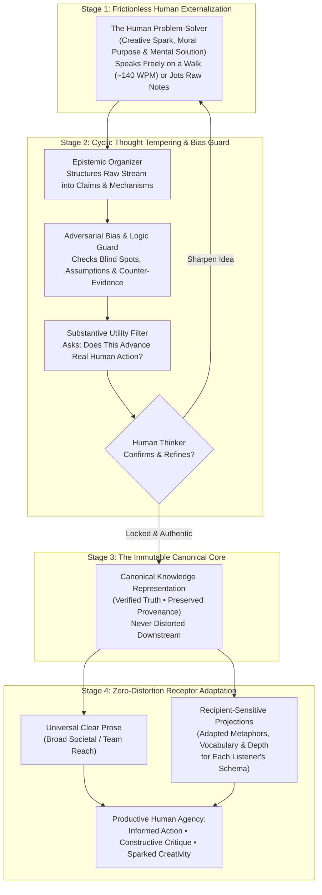
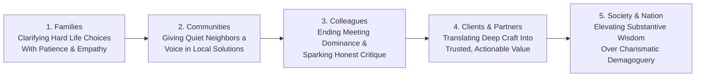
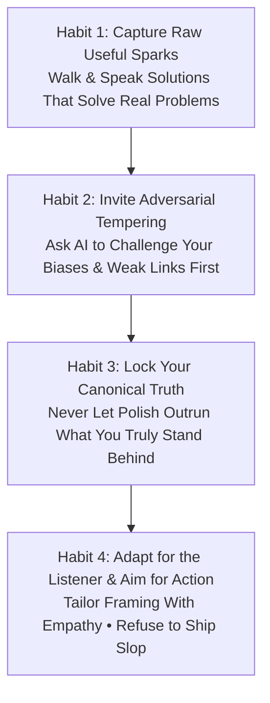

> [!tip] Audience & Live Companion Experiment
> **Who this page is for:** Thoughtful citizens, founders, technologists, educators, and civic leaders navigating the hopes, confusion, and fears of the 2026–2027 AI transition.  
> **Live Receptor-Adaptation Proof:** This monograph and its companion enterprise blueprint—[[Essays/liberating-trapped-brilliance|Liberating Trapped Brilliance: Ending the Charisma Tax in Enterprise Decisions]]—were compiled without distortion from the exact same November 19, 2026 walking voice dictation, proving in practice that one immutable canonical truth can speak powerfully to two distinct audiences. See also [[Essays/epistemic_communication_and_ai|Signal Fidelity and Epistemic Communication in the Age of AI]].

---

# The Cognitive Equalizer

### Reclaiming Artificial Intelligence from Generative Slop to Unlock Trapped Human Genius and Purposeful Action

#### *Why Society Confuses Charisma With Wisdom, Why Passive AI Entertainment Wastes Our Era, and How Canonical AI Amplifies Quiet Problem-Solvers Across Families, Communities, Workplaces, and Nations*

---

## Prologue & Executive Thesis: The Question for 2027

Stand still for a moment at the threshold of 2027 and take the emotional pulse of our society around artificial intelligence. Beneath the breathless product launches and trillion-dollar data-center headlines, ordinary people feel a profound, entirely understandable mixture of **hope, confusion, and quiet dread**. In **Pew Research Center** polling across 2025 and 2026, **52% of Americans say they feel more concerned than excited** about AI in daily life—nearly six times the **9%** who feel primarily excited, with another **37%** caught in ambivalent uncertainty—while **63%** sense the technology is hurtling forward faster than human wisdom or institutions can steward it. Young adults worry their hard-earned skills will be devalued before their careers begin; experienced professionals wonder whether human judgment is being sidelined; citizens look at algorithmic feeds choked with synthetic junk and ask: *Is this really making human life better?*

To answer that question honestly, we must start by asking a deeper question about human civilization itself:

> **Which of these three conditions poses the greatest danger to a society?**  
> 1. *A foolish person who is a masterful, persuasive communicator;*  
> 2. *A malicious person who is a masterful, persuasive communicator; or*  
> 3. *A brilliant, well-intentioned thinker whose life-improving solution remains trapped inside their head—dismissed in thirty seconds because they cannot communicate it persuasively?*

History is scarred by the first two, yet our future is silently impoverished every single day by the third. Across neighborhoods, school boards, hospitals, engineering shops, corporate meetings, and national policy debates, millions of people carry extraordinary problem-solving intuition inside their minds. They see how to fix a broken process, avert a preventable failure, or uplift a community—yet because human talents are unevenly distributed, their spoken words come out hesitant, tangled, or mistimed in a crowded room. Society shrugs, mistakes unpolished delivery for weak thinking, and hands the microphone back to the loudest voice at the table.

Meanwhile, look at what we are doing with the most powerful cognitive technology ever invented. In a society where **U.S. Bureau of Labor Statistics (*American Time Use Survey*)** data shows adults already spend **5.0 to 5.5 hours every single day** in leisure—overwhelmingly passive television, streaming, and screen consumption—vast oceans of AI compute, engineering talent, and electricity are being poured into **frivolous, zero-utility entertainment spam ("AI slop")** and hollow workplace noise (**"workslop"**). We are building digital cotton-candy machines for a civilization starving for nourishment.

This monograph argues for a moral and architectural course correction: **Artificial intelligence was not meant to replace the human thinker or sedate the human spirit with endless synthetic amusement. Its noblest purpose is to serve as a *Cognitive Equalizer*—rescuing substantive human wisdom from the prison of imperfect expression and translating it into productive action.**

---

## 1. The Charisma Asymmetry: Why Society Dismisses Quiet Genius

### 1.1 Mistaking the Package for the Truth

We like to believe we live in a meritocracy of ideas—that if a solution is true and useful, people will naturally recognize its worth. Behavioral science proves otherwise. When human beings gather to evaluate ideas without structured safeguards, we rely on ancient evolutionary shortcuts that systematically confuse **theatrical fluency** with **intellectual validity**:

* **The Babble Hypothesis (*MacLaren et al., The Leadership Quarterly, 2020*)**: Across rigorous team simulations controlling for intelligence, personality, and gender, researchers proved that **sheer speaking volume** directly predicts who emerges as an influential leader. Groups instinctively treat *airtime* as competence, elevating relentless talkers while overlooking reflective thinkers who speak only when they hold high-signal truth.
* **The Confidence Heuristic (*Anderson, Brion, Moore & Kennedy, JPSP, 2012*)**: Overconfident individuals project louder vocal tone, rapid certainty, and assertive posture—cues that hijack group perception and secure high social status **regardless of objective accuracy**. Strikingly, even after overconfident voices are proven factually wrong, they rarely lose the status they captured, whereas careful, honest thinkers who acknowledge nuance are discounted from the start.

### 1.2 Not Only Lone Inventors: "The Edgewise Problem" in Everyday Life

Trapped brilliance is not confined to solitary inventors sketching breakthroughs in a garage. Its most pervasive casualties happen in **ordinary, synchronous group decisions**—a family navigating a difficult eldercare choice, a community board debating a local crisis, or a twelve-person engineering meeting where two forceful personalities commandeer fifty-five minutes of a sixty-minute hour.

In a landmark *Science* study of **699 people** working in groups, **Anita Williams Woolley, Christopher Chabris, Alex Pentland, and Thomas Malone** discovered that a group's collective intelligence (its **$c$ factor**) was *not* predicted by the average IQ of its members or even the IQ of its smartest person. Instead, collective intelligence rose and fell on **conversational turn-taking equality** and mutual social sensitivity: whenever one or two dominant speakers monopolized the floor, **the entire group became measurably less intelligent**.

Complementing this, Wharton professors **Karan Girotra, Christian Terwiesch, and Karl Ulrich** (*Management Science*, 2010) proved that when people develop ideas **asynchronously and independently first** before convening as a group, they generate **roughly three times as many ideas** and surface **dramatically superior breakthrough solutions** compared to real-time group brainstorming. Live rooms reward fast talkers; quiet reflection births deep breakthroughs.

---

## 2. The Plague of Frivolous AI: Digital Slop in an Over-Entertained Age

### 2.1 The Abundance-of-Leisure Paradox

Walk through any airport, living room, or breakroom in late 2026 and observe what fills human idle moments. Humanity does not suffer from an entertainment deficit. With **5+ hours per day** already absorbed by leisure and passive screens (*BLS ATUS*), we swim in the most saturated entertainment environment in human history.

Yet a massive share of generative AI's public footprint has been steered toward generating synthetic curiosities, surreal throwaway videos, meme spam, and algorithmic filler—thoughts that may amuse for four seconds, consume megawatts of AI bandwidth, and leave the viewer no wiser, no kinder, and no more capable of contributing to the world around them.

Worse, that same uncritical habit has spilled directly into professional life. In September 2025, **BetterUp Labs and the Stanford Social Media Lab** published landmark findings in the *Harvard Business Review* (*"AI-Generated 'Workslop' Is Destroying Productivity"*):
* **40% of desk workers** now receive AI-generated *workslop*—polished-looking text or slides devoid of real thought—every month.
* Each piece of workslop steals **nearly two hours** from the human recipient forced to untangle it (costing large organizations **~\$9 million per 10,000 workers annually**), while breeding cynicism, distrust, and institutional *knowledge decay*.

### 2.2 Drawing a Clear Line: Passive Amusement vs. Communication for Action

If we want 2027 to mark the year AI begins healing rather than hollowing out society, we must recover a classical distinction between **communication for amusement** and **communication for agency**:

| Dimension | Frivolous / Slop AI Usage | Substantive / Cognitive-Equalizer AI Usage |
| :--- | :--- | :--- |
| **Origin of Spark** | Trivial whim or 5-word lazy prompt ("write my update"). | Genuine human problem-solving, lived care, or hard-won insight. |
| **Effect on Truth** | Inflates shallow noise into slick, deceptive polish. | Stress-tests logic, guards against bias, and distills canonical truth. |
| **Effect on the Recipient** | Consumes scarce attention; induces passivity or rework fatigue. | Respects cognitive bandwidth; adapts framing for instant clarity. |
| **Ultimate Telos (Goal)** | Fleeting distraction, vanity metrics, or performative busyness. | **Productive Action**: solving problems, inviting sharp critique, sparking co-creation, and bettering families, communities, colleagues, clients & nations. |

We do not need to ban human play or artistic craft to recognize a simple civilizational priority: **the overwhelming majority of our AI ingenuity and compute should be aimed at elevating substantive human thought and constructive action.**

---

## 3. Architecture of the Cognitive Equalizer: How Human Spark + AI Partnership Works

How, concretely, can AI liberate the brilliant but unpolished thinker without turning into a ghostwriter of synthetic slop? The **Cognitive Equalizer** operates as a disciplined **Four-Stage Human-AI Partnership**:

### 3.1 Stage 1: Releasing the Idea From the Mind (Overcoming the Blank Page)
When people try to type high-stakes ideas from scratch, self-consciousness over phrasing slows effective expression to single-digit words per minute (~3.3 WPM). Speaking aloud on a quiet walk—or dictating an unvarnished voice note the moment a solution clicks—unlocks natural reasoning at **110–150 WPM**. The thinker focuses 100% on *what is true and useful*, zero percent on rhetorical polish.

### 3.2 Stage 2: AI as Honest Mirror, Bias Guard & Quality Crucible
Left alone, a single chatbot prompt will flatter whatever the user says (*LLM sycophancy*). Instead, the Cognitive Equalizer routes raw thoughts through a **Cyclic Multi-Persona Tempering Loop**:
* One persona organizes messy spoken loops into clean premises and causal steps;
* A **Bias & Blind-Spot Guard** pushes back gently (*"Where might confirmation bias be hiding here? What evidence would disprove this? Whose perspective is missing?"*); and
* A **Utility Filter** asks how the idea translates into constructive action.
Crucially, **the human thinker stays in the driver's seat**, answering those challenges until the idea itself is stronger, fairer, and sharper than when the walk began.

### 3.3 Stage 3 & Stage 4: Invariant Canonical Truth $\rightarrow$ Receptor-Sensitive Empathy
Once the thinker ratifies their **Canonical Core**, a profound act of communicative empathy becomes possible—grounded directly in **Clark and Murphy's *Audience Design*** and **Kalyuga and Sweller's *Expertise Reversal Effect*** (*PubMed*, 2011).

Cognitive load science proves that **using the exact same words for every listener is not "fairness"—it is communicative negligence**. A technical veteran forced through elementary explanations suffers *expertise reversal* overload ($d \approx -0.43$), while a lay citizen handed dense specialist jargon is locked out ($d \approx 0.51$ benefit from appropriate scaffolding).

By holding the **Canonical Core strictly invariant** while adapting *only* the receptor interface—the metaphors, examples, reading length, and framing—one worthwhile human insight can speak clearly to a broad public readership, a skeptical specialist invited to offer critique, a busy executive needing trade-offs, or a neighbor from a completely different walk of life—without bending or distorting the underlying truth by a single degree.

---

## 4. Circles of Substantive Impact: From the Dinner Table to the Nation

When we stop treating AI as an entertainment slot machine and start wielding it as a Cognitive Equalizer, its benefits ripple outward across five concentric circles of human responsibility:

1. **Better Families**: Helping family members think through complex healthcare, financial, educational, or caregiving decisions calmly—checking emotional blind spots and expressing difficult truths to loved ones across generational gaps with clarity and grace rather than heat.
2. **Better Communities**: Enabling the quiet teacher, volunteer engineer, or neighborhood parent who sees a practical fix for a school or civic problem—but dreads three-minute town-hall microphones—to place a clear, evidence-backed, constructive proposal in front of neighbors.
3. **Better Colleagues**: Replacing loud synchronous meeting dominance and two-hour *workslop* dumps with asynchronous **Equal-Voice Side-Channels**, where quiet team members get their best warnings and creative sparks onto the table—and invite peers to critique and improve them.
4. **Better Clients**: Honoring client trust by translating deep technical or operational realities into receptor-adapted briefings that empower confident, well-informed action.
5. **A Stronger Society & Nation**: Immunizing public life against charismatic folly and persuasive malice by lowering the rhetorical barrier for honest, substantive problem-solvers everywhere.

---

## 5. How Anyone Entering 2027 Can Begin Tomorrow (A Practical Covenant)

You do not need an enterprise software cluster to practice this shift starting tomorrow morning. Whether you are a student, parent, engineer, teacher, or executive navigating the uncertainties of 2027, four personal habits turn AI from a source of anxiety into an instrument of earned agency:

1. **Audit Your AI Diet (Starve the Slop)**: Refuse to spend your finite attention—or AI's capacity—generating or forwarding hollow entertainment spam and unexamined *workslop*. Ask of every prompt: *Does this help someone think more clearly, build something worthwhile, or act for the good of others?*
2. **Rescue One Trapped Idea a Week**: Next time you solve a problem in your head—or leave a crowded meeting having been unable to get a word in edgewise—record a five-minute voice walk explaining your raw reasoning.
3. **Demand Critique Before Polish**: Instruct your AI partner *not* to flatter you or immediately write pretty prose, but first to act as a **Bias & Logic Challenger**: *"Organize my core claim, point out my blind spots or unstated assumptions, and help me make the solution genuinely sound."*
4. **Translate With Empathy, Never Distortion**: Once the core idea is solid and authentically yours, tailor how you share it to the people who need to hear it—matching their language and lived experience while inviting their honest feedback, creative spark, and shared action.

---

## Conclusion: A Worthier Horizon for Artificial Intelligence

Much of our collective anxiety entering 2027 stems from a false story that AI is here to out-talk us, out-create us, or drown us in synthetic distraction. The truth is simpler and far more hopeful: **machines do not care about families, neighbors, craft, or justice—human beings do.**

Every single day, extraordinary human insights die unspoken behind ordinary communication barriers while persuasive folly commands the stage. If we dedicate the lion's share of our artificial intelligence resources to unlocking those quiet thinkers—helping people think more rigorously, check their own biases, honor each listener's comprehension, and inspire one another to productive action—we will not lose our humanity in the age of AI. For the first time in history, we will hear the full intelligence of the human family.

---

## References

1. **MacLaren, N. G., Yammarino, F. J., Dionne, S. D., et al.** (*The Leadership Quarterly*, 2020) — *"Testing the babble hypothesis: Speaking time predicts leader emergence in small groups"*: https://orb.binghamton.edu/management_fac/2/
2. **Anderson, C., Brion, S., Moore, D. A., & Kennedy, J. A.** (*Journal of Personality and Social Psychology*, 2012) — *"A status-enhancement account of overconfidence"*: https://pubmed.ncbi.nlm.nih.gov/22800286/
3. **Woolley, A. W., Chabris, C. F., Pentland, A., Hashmi, N., & Malone, T. W.** (*Science*, 2010) — *"Evidence for a Collective Intelligence Factor in the Performance of Human Groups"*: https://pubmed.ncbi.nlm.nih.gov/20929725/ and MIT News summary: https://news.mit.edu/2010/collective-intel-1001
4. **Girotra, K., Terwiesch, C., & Ulrich, K. T.** (*Management Science*, 2010 / Wharton Mack Institute) — *"Idea Generation and the Quality of the Best Idea"*: https://mackinstitute.wharton.upenn.edu/2010/idea-generation-and-the-quality-of-the-best-idea/
5. **Kalyuga, S., & Sweller, J.** (*PubMed* / Cognitive Load Theory, 2011) — *"The Expertise Reversal Effect"* (paired with Clark, H. H., & Murphy, G. L., 1982, *Audience Design in Meaning and Understanding*): https://pubmed.ncbi.nlm.nih.gov/21443379/
6. **Niederhoffer, K., Hancock, J. T., Kellerman, G. R., Lee, A., Liebscher, A., & Rapuano, K.** (BetterUp Labs & Stanford Social Media Lab, *Harvard Business Review*, September 22, 2025) — *"AI-Generated 'Workslop' Is Destroying Productivity"*: https://www.betterup.com/workslop and https://store.hbr.org/product/ai-generated-workslop-is-destroying-productivity/H08WF1
7. **Pew Research Center** (2025–2026 Public Attitudes Toward Artificial Intelligence Surveys, including August 18, 2026 release): https://www.pewresearch.org/short-reads/2026/08/18/young-adults-in-the-us-are-increasingly-wary-of-ai-concerned-it-will-take-jobs/
8. **U.S. Bureau of Labor Statistics (BLS)** — *American Time Use Survey (ATUS): Time Spent in Leisure and Sports*: https://www.bls.gov/opub/ted/2025/time-spent-in-leisure-and-sports-in-2024.htm
9. **Companion Blueprint in This Garden**: [[Essays/liberating-trapped-brilliance|Liberating Trapped Brilliance: Ending the Charisma Tax in Enterprise Decisions Through Canonical Thought Tempering and Receptor-Adapted AI]].

