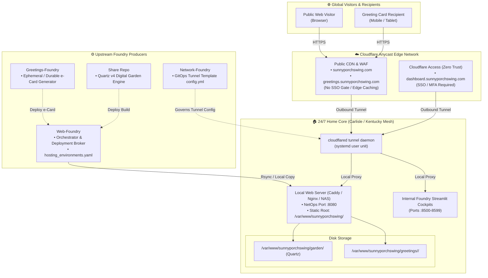

# Foundry Warning Order (WARNORD): Durable Public Web Ingress & Sovereign Hosting via Cloudflare

**Document ID:** `WARNORD-20261101-151000-DURABLE-WEB-INGRESS-ALIGNMENT`  
**From:** Founder & Antigravity Assistant  
**To:** `Network-Foundry`, `Web-Foundry`, `NetOps-Control-Plane`, `Greetings-Foundry`, `Share`, `Manage-Foundry`, `Hints-Foundry`  
**Date:** 2026-11-01 15:10:00-05:00  
**Classification:** Strategic Architecture Warning Order / Public Ingress Alignment  
**Status:** Approved Intent — Execution Phased Across Upcoming Iterations  

---

## 1. Executive Summary & Strategic Decision

Following strategic architectural evaluations regarding public web delivery, sovereign asset ownership, and multi-foundry synergies, the Founder has approved a strategic realignment of our external web presence:

1. **Sovereign Local-First Durable Web Hosting:** Transition primary public web publication from third-party hosting providers (GitHub Pages, Netlify, Fastmail Files) to local web roots hosted on always-on home nodes (e.g., `home-linux-3` / Synology NAS Web Station).
2. **Cloudflare Global Edge Acceleration & Ingress:** Utilize Cloudflare Tunnels (`cloudflared`) to associate our vanity domain (`sunnyporchswing.com`) and subdomains directly with internal ports without opening router firewall ports.
3. **Public vs. Protected Delineation:**
   - **Public Web Ingress (Zero SSO Required):** `sunnyporchswing.com` (Digital Garden) and `greetings.sunnyporchswing.com` (Personalized e-cards) will be explicitly designated as public endpoints, with no Cloudflare Access or GitHub authentication barrier. Cloudflare's Anycast CDN will cache static assets globally, protecting home ISP bandwidth.
   - **Internal / Administrative Ingress (Strictly Protected):** Subdomains like `dashboard.sunnyporchswing.com`, desktop web terminals, and Streamlit cockpits remain strictly gated behind Cloudflare Access SSO (Google/GitHub/Email OTP) or private Tailscale mesh.
4. **Fastmail & Netlify Strategic Demarcation:**
   - **Fastmail Files:** Retained for large video/screencast shares (>100MB) and non-HTML binary distribution (adhering to Cloudflare ToS section 2.8).
   - **Netlify & GitHub Pages:** Maintained purely as secondary backup/staging fallbacks rather than primary production hosting.

---

## 2. Federated Architecture Overview



---

## 3. Specific Foundry Directives & Warning Orders

### A. To `Network-Foundry`:
* **GitOps Ingress Registration:** Update `foundry/network/templates/cloudflare/config.yml` to define clean ingress rules for:
  - `sunnyporchswing.com` -> `http://localhost:8080` (or designated local port).
  - `greetings.sunnyporchswing.com` -> `http://localhost:8080/greetings` (or dedicated port :8511).
* **Access Policy Boundary Verification:** Ensure that no Cloudflare Access Application policy is applied to `greetings.sunnyporchswing.com` or `sunnyporchswing.com`, guaranteeing open public readability.
* **Failover Readiness:** Validate that if the primary Carlisle node is offline, ingress can route across the Tailscale mesh to Kentucky Farm Lab nodes seamlessly.

### B. To `Web-Foundry`:
* **Hosting Environment Definition:** Update `hosting_environments.yaml` to declare a new first-class target:
  ```yaml
  home_durable_edge:
    title: "Sovereign Cloudflare Home Edge"
    type: "Local-Edge"
    status: "Active"
    port: 8080
    staging_path: "staging/home-edge"
    target_path: "/var/www/sunnyporchswing/"
    public_url_base: "https://sunnyporchswing.com"
    deploy_mechanism: "Local File System / Rsync"
    capabilities: ["Static HTML", "CSS", "JS", "Audio Embeds", "Global CDN Caching"]
  ```
* **Deployment Broker Logic:** Add a local deployment runner to deploy staging artifacts directly into the local web root.

### C. To `NetOps-Control-Plane`:
* **Port Reservation:** Authoritatively reserve port `8080` (or alternate selected port) for the sovereign web daemon (`sovereign_static_web_edge`) to eliminate collisions with dynamic Streamlit services.

### D. To `Share` (Digital Garden):
* **Local Build Pipeline Hook:** Augment the Quartz publishing workflow (`scripts/` or `quartz-sync.sh`) to support building directly into the local web root (`/var/www/sunnyporchswing/garden` or root) alongside GitHub Pages synchronization.

### E. To `Greetings-Foundry`:
* **Canonical URL Update:** Transition output links from Netlify/ephemeral GitHub URLs to branded canonical URLs: `https://greetings.sunnyporchswing.com/<card-id>/`.
* **Asset Packaging:** Ensure generated cards package relative paths cleanly for hosting under the sovereign web root.

### F. To `Manage-Foundry` (Chief of Staff):
* **Tracking & Backlog Ingestion:** Ingest this strategic transition into `suite.yaml` capability records and surface associated action items in daily cockpit generation (`next_actions.md`).

---

## 4. Execution Timeline

* **Phase 1 (Immediate / Week 1):** NetOps port reservation and Network-Foundry Cloudflare Tunnel template staging.
* **Phase 2 (Week 2):** Local static web server configuration on 24/7 host; verify public resolution of `sunnyporchswing.com` via Cloudflare edge.
* **Phase 3 (Week 3):** Web-Foundry deployment handler integration; test deploying an ephemeral greeting card under `greetings.sunnyporchswing.com`.
* **Phase 4 (Week 4):** Quartz digital garden dual-publication to local root; audit performance and CDN caching headers.

*Issued by Founder & Antigravity Assistant for federated ingestion across Foundry Suite inboxes.*
